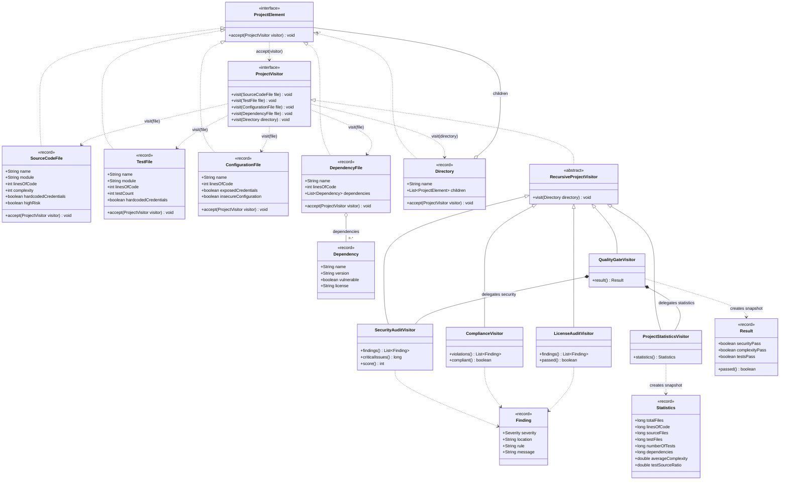

# UML — Smart Code Inspection & Compliance Engine

GitHub renders the Mermaid diagrams below. Names and relationships match the Java
implementation. Records are shown as classes.

## Class diagram



`Statistics` is nested in `ProjectStatisticsVisitor`, `Result` in
`QualityGateVisitor`, and the `Severity` enum in `Finding`. Each concrete visitor
implements the four file overloads and inherits `visit(Directory)` from
`RecursiveProjectVisitor`. `Dependency` is supporting data, not a sixth element.

Directory children use aggregation because the model does not enforce exclusive
ownership. The same object can appear more than once and is processed per entry.

## Sequence diagram

Example: `SecurityAuditVisitor` processes the root, the `src` directory, and `PaymentService.java`.

```mermaid
sequenceDiagram
    participant Main
    participant Root as root:Directory
    participant Audit as audit:SecurityAuditVisitor
    participant Src as src:Directory
    participant Payment as payment:SourceCodeFile
    Main->>Root: accept(audit)
    Root->>Audit: visit(this: Directory)
    Note over Audit: inherited RecursiveProjectVisitor.visit(Directory)
    Audit->>Src: child.accept(this)
    Src->>Audit: visit(this: Directory)
    Audit->>Payment: child.accept(this)
    Note over Payment: First dispatch selects SourceCodeFile.accept
    Payment->>Audit: visit(this: SourceCodeFile)
    Note over Payment,Audit: Overload selected using this:SourceCodeFile; second dispatch selects SecurityAuditVisitor.visit
    Audit->>Audit: credentials(name, true)
    Audit->>Audit: record CRITICAL and high-risk WARNING
    Audit-->>Payment: return
    Payment-->>Audit: return
    Audit-->>Src: return
    Src-->>Audit: return
    Note over Audit: Continue remaining children using the same visitor
    Audit-->>Root: return
    Root-->>Main: return
    Main->>Audit: findings(), criticalIssues(), score()
    Audit-->>Main: immutable snapshot and calculated results
```

Other visitors use the same `accept/visit` protocol. `QualityGateVisitor`
delegates file processing to its internal visitors without traversing directories
a second time.
